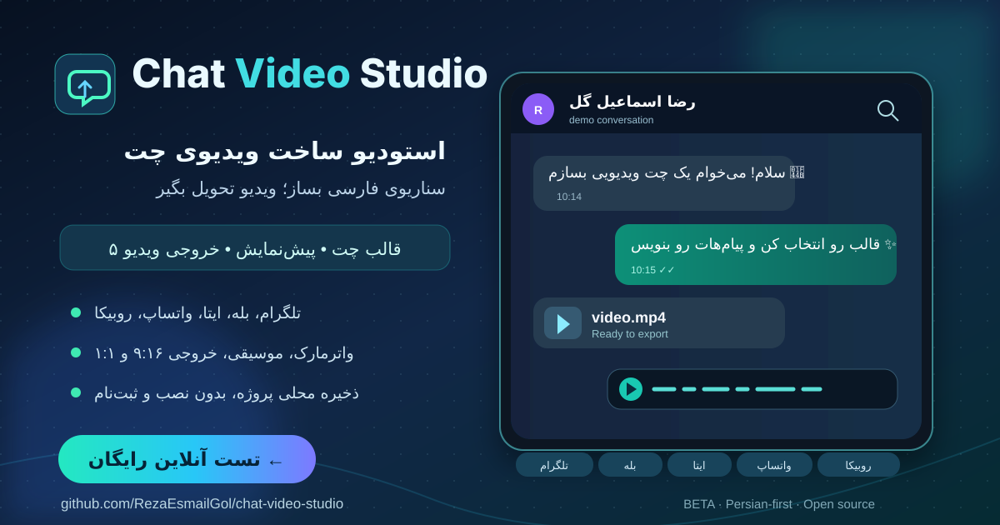

# 🎬 Chat Video Studio
**Persian-first fictional chat video creator — entirely in your browser**

[🌐 Live demo](https://rezaesmailgol.github.io/chat-video-studio/) · [🇮🇷 راهنمای فارسی](./README.md) · [🐛 Issues](https://github.com/RezaEsmailGol/chat-video-studio/issues) · [🤝 Contribute](./CONTRIBUTING.md)

> [!IMPORTANT]
> **Public beta.** Create fictional or authorized conversations only. Never represent generated chats as authentic evidence or impersonate others. Messenger-inspired skins are **unofficial** recreations, not affiliated with their respective services.

## Features

Build a two-sided conversation, configure delivery timing, preview animated messages, and export an image or video.

| Area | Currently available |
|---|---|
| Messenger skins | Telegram, WhatsApp, Bale, Eitaa, Rubika |
| Conversation editing | Text, images, emoji, replies, delays, undo/redo |
| Exports | PNG images; MP4 or WebM video depending on browser support |
| Layouts | Vertical 9:16, square 1:1, landscape 16:9 |
| Customization | Text watermark, locally selected background music, chroma-key green backdrop |
| Projects | Multiple local projects in IndexedDB; JSON import and export |
| Story starters | Three Persian scenarios plus an editable, template-based custom script |
| Deployment | Application logic lives in **one index.html file**; no account or backend required |

The artwork above is an **illustration**, not a pixel-accurate screenshot of the current UI.

## Quick start

**Online:** [Open the live demo](https://rezaesmailgol.github.io/chat-video-studio/).

**Local:** Clone this repository and open <code>index.html</code> in a modern browser. If direct file access causes restrictions, serve the folder with:

    git clone https://github.com/RezaEsmailGol/chat-video-studio.git
    cd chat-video-studio
    python -m http.server 8000

Then visit [localhost:8000](http://localhost:8000). No Node.js build step or application backend is needed; some fonts, emoji, or third-party libraries may still require internet access.

### Create your first video

1. Choose one of the five messenger-style templates.
2. Edit the example conversation or load a Persian story starter.
3. Adjust contact avatar, message text, sender side, replies, and timing.
4. Choose aspect ratio, watermark, and optional background music.
5. Preview, export video, and verify the downloaded file. The browser selects a supported **MP4 or WebM** container.
6. Download a JSON backup before clearing browser data or switching devices.

## Compatibility and important limitations

| Environment | Verification |
|---|---|
| Chromium / Chrome desktop | Five previews, project library, and sample video exports tested |
| Firefox desktop | Previews, local project management, and WebM tested |
| Responsive widths 320–1280 px | Automated layout checks completed |
| Real iPhone/Safari and Android devices | **Not yet certified** |
| Long videos and memory-constrained devices | Additional testing needed |

- The 1080p-size option **upscales from a 750×1334 canvas**; it is not a native Full HD renderer.
- Background music with a WebM/Opus audio track was verified in Chromium. An MP4 with audio is **not guaranteed** in every browser.
- Motion in attached video clips is experimental and not validated in all recording paths.
- Green Screen is a **solid chroma-key green** backing, not an alpha-transparent export.
- The editable custom-script builder is currently **offline and rule/template based**, not connected to a generative AI model.
- Selected background music is session-only and must be selected again after reload.
- Projects are stored locally. Clearing site data, changing browser profiles, or switching devices may remove access to them without a JSON backup.

[Latest verified V2 browser run](https://github.com/RezaEsmailGol/chat-video-studio/actions/runs/39745568024)

## Architecture and privacy

The application ships as a single <code>index.html</code> with inline main JavaScript/CSS. Images and documents in this repository are **repository assets**, not additional runtime app files. Projects are saved using browser **IndexedDB**. There is no account system or chat-upload backend. However, third-party fonts, libraries, and emoji assets can make external network requests; do not assume offline-only operation.

Do not put API keys, credentials, or personal secrets in publicly hosted HTML. Connecting a real generative model securely would require a protected server-side proxy or equivalent architecture.

## Roadmap

- [x] Five messenger-style skins and editable Persian story starters
- [x] Local multi-project library and JSON backups
- [x] Multiple ratios, watermark, background music and experimental chroma-key
- [ ] Real-device Safari/iPhone and Android validation
- [ ] Long-duration and low-memory performance tests
- [ ] Native Full HD rendering and reliable advanced media attachments
- [ ] Optional Persian generative AI through secure server-side integration

## Contribute and report issues

Issues and pull requests are welcome. See [CONTRIBUTING.md](./CONTRIBUTING.md), [SECURITY.md](./SECURITY.md), and [CHANGELOG.md](./CHANGELOG.md). For help, provide the browser, operating system, reproduction steps and (if appropriate) an anonymized sample project. **Never post private conversations, credentials or personal data publicly.**

## License and credits

Original project code: [MIT License](./LICENSE). Third-party brands, trademarks, logos, images, and assets retain their respective rights and licenses. No affiliation with any messenger operator is implied.

Created by [Reza Esmail Gol](https://github.com/RezaEsmailGol).

[فارسی](./README.md) · [Live demo](https://rezaesmailgol.github.io/chat-video-studio/) · [GitHub](https://github.com/RezaEsmailGol/chat-video-studio)
